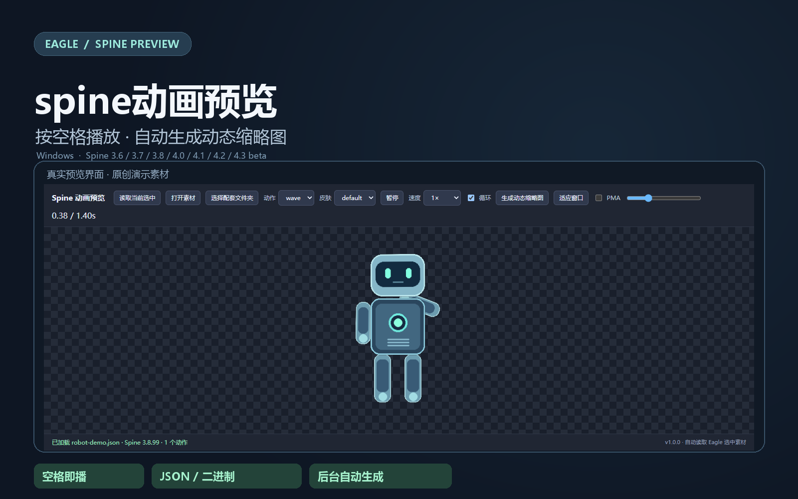

# spine动画预览

在 Eagle 中按空格播放 Spine 动画，并自动生成动态缩略图。



## 功能

- 选择骨骼或图集，按空格自动播放，也可从插件菜单打开。
- 切换动作、皮肤、播放速度和循环，支持时间轴、缩放和平移。
- 后台生成动态缩略图，无需先打开素材；后台保留已有自定义缩略图。
- 按当前动作手动生成动态缩略图。

## 环境与支持范围

当前仅支持 **Windows**，本机验证环境为 **Eagle 4.0.0 build 20260401**。需要可用的 Eagle 本地 API 和 `/api/v2/` 接口；更早版本兼容性尚未验证。

支持 Spine **3.6、3.7、3.8、4.0、4.1、4.2、4.3**。4.3 为当前测试的 beta 版本，不保证所有 beta 更新或未来版本兼容。

支持 JSON、二进制骨骼及常见 Unity 导出后缀：`.skel`、`.skel.bytes`、`.bytes`、`.json`、`.json.txt`、`.json.bytes`、`.txt`；配套图集支持 `.atlas`、`.atlas.txt`、`.atlas.bytes`。ZIP/`.spinezip` 支持预览，后台识别素材包建议使用 `.spinezip`。

文件内容必须是 Spine 导出数据，需要配套图集和纹理；不直接播放编辑器 `.spine` 工程。

## 使用

1. 安装插件后，完全退出并重启 Eagle。
2. 将骨骼、图集和全部纹理一起导入，建议放在同一个 Eagle 文件夹。
3. 选中骨骼或图集，按空格播放；后台也会自动检查并生成缩略图。

查看 [完整使用说明](docs/usage.zh-CN.md)、[中文插件描述](docs/description.zh-CN.md) 或 [English description](docs/description.en.md)。

## 后台与数据处理

后台约每5秒检查当前素材库，读取相关本地文件，更新缩略图及尺寸元数据，不覆盖原始骨骼、图集或纹理。缩略图最长3秒、20fps、最大边256像素。停用插件会停止后台工作；已经生成的缩略图保留。

通过 `127.0.0.1:41595` 与 Eagle 本地 API 通信，不上传素材到外部服务。生成使用系统临时文件，完成后清理。后台运行状态记录在插件目录的 `status.json`，不纳入版本控制或发布包。

## 源码与打包

```text
plugin/              Eagle 插件源码、manifest 和运行库
docs/                描述、使用说明、封面与截图
samples/robot-demo/  原创机器人演示素材
```

开发时在 Eagle 插件开发菜单加载 `plugin/` 目录。通过 Eagle 插件列表的“打包插件 / Pack Plugin”导出 `.eagleplugin`；不要把普通 ZIP 改后缀作为官方安装包。导出前排除运行生成的 `status.json`，并验证最终安装包在独立位置安装后可用。

本仓库当前提供源码与使用资料，尚未附加官方导出的安装包。

## 示例

将 [原创机器人示例](samples/robot-demo)中的 `robot-demo.json`、`robot-demo.atlas` 和 `robot-demo.png` 一起导入 Eagle，按空格播放 `wave` 动作。示例已在插件查看器中验证加载和动画播放，可用于演示和随插件分发。

## 第三方依赖

使用 Esoteric Software 的 Spine Runtimes，许可证和版权声明见 [第三方说明](plugin/THIRD_PARTY_NOTICES.md) 及 `plugin/vendor/LICENSE*.txt`。运行库集成与分发遵循 [Spine Editor License Agreement](https://esotericsoftware.com/spine-editor-license) 第2节。本插件为独立开发作品。
